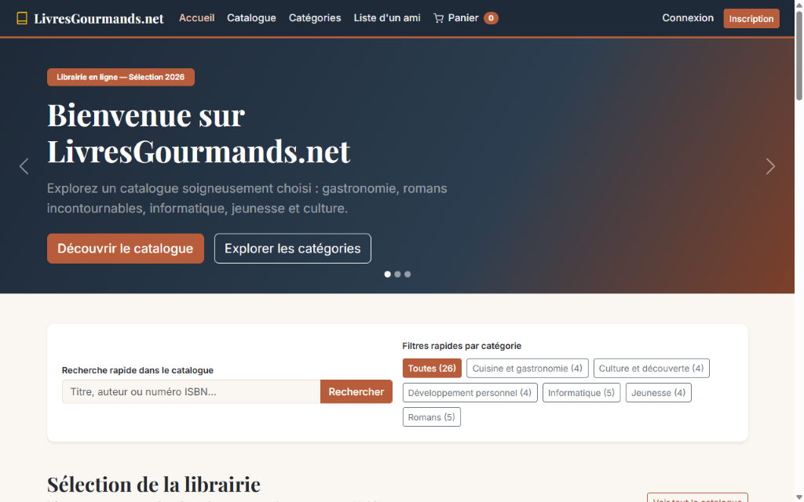
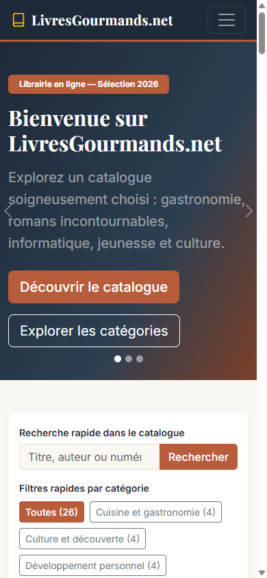
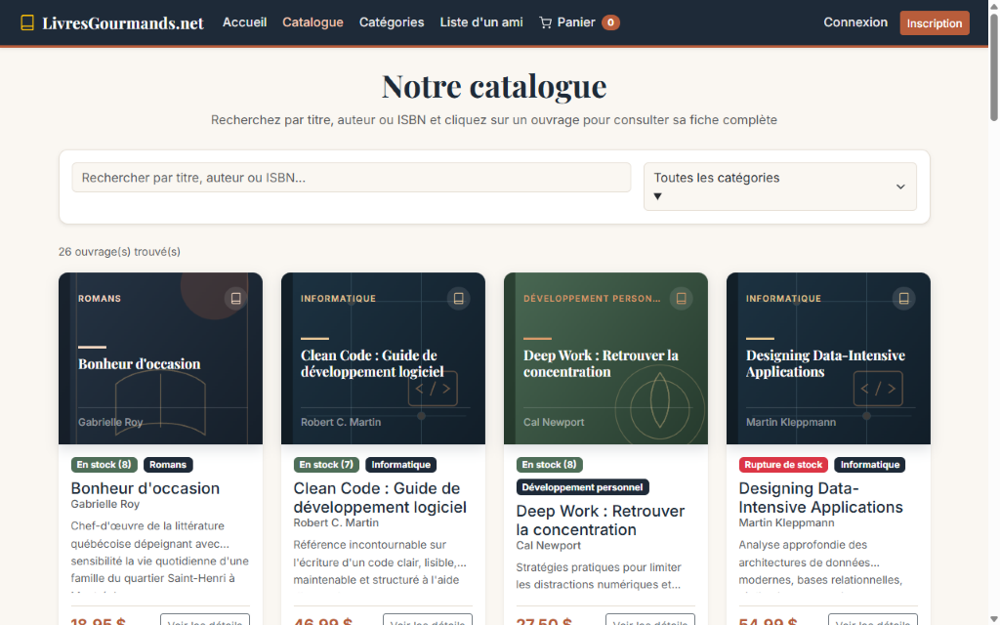
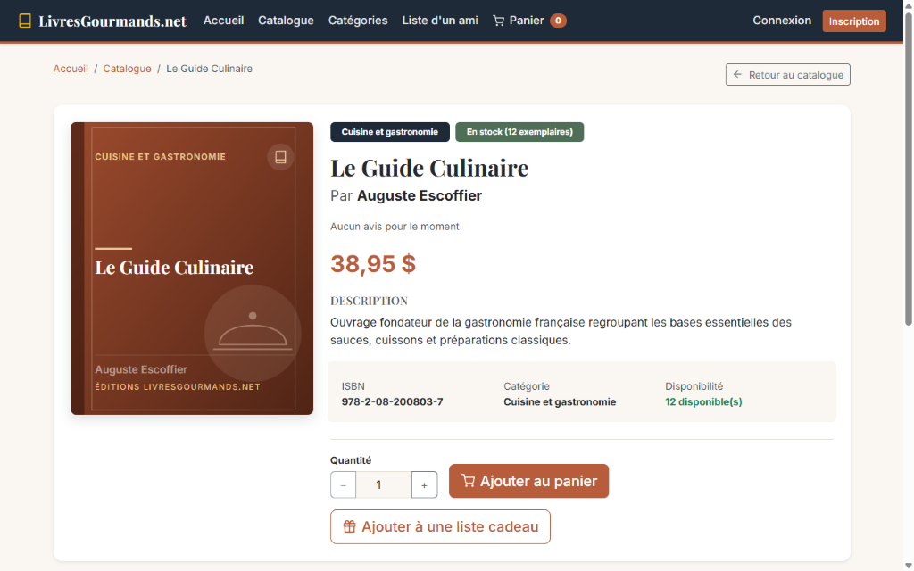
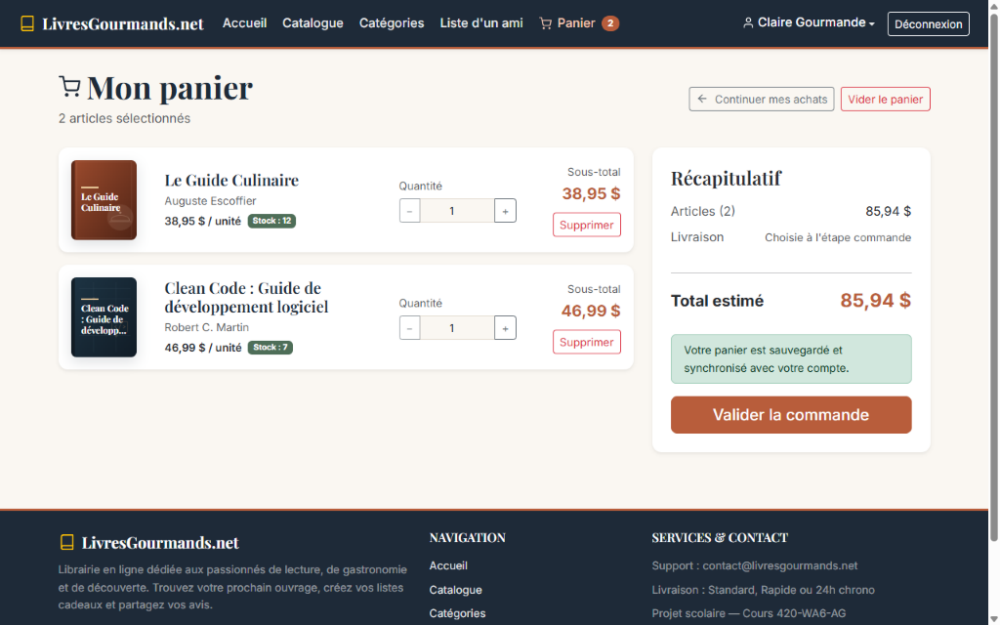
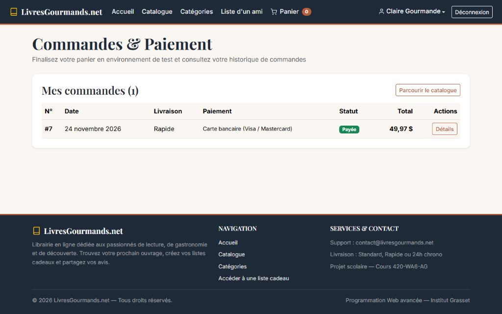
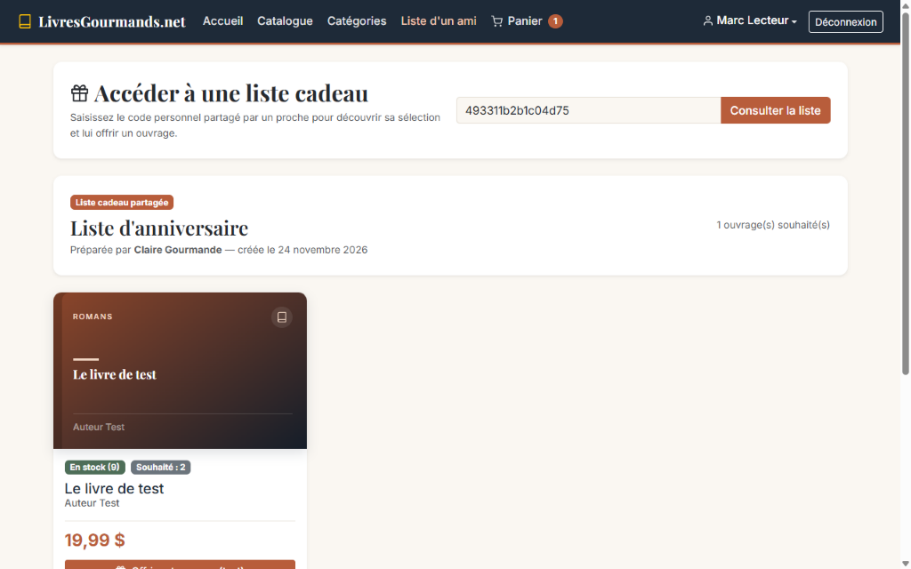
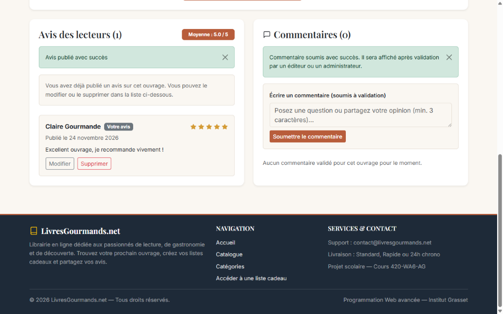
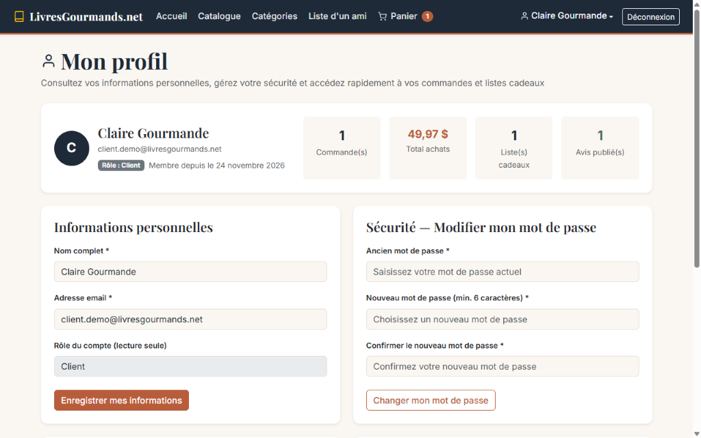
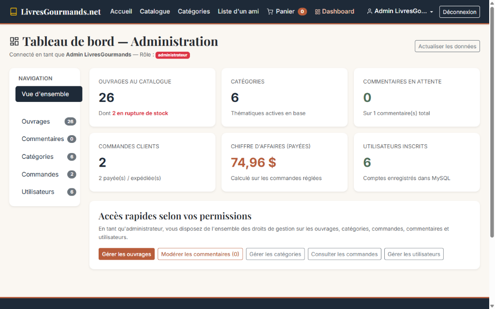

# LivresGourmands.net — Librairie en ligne (Étape 03)

Application web e-commerce complète de vente de livres en ligne (**React + React Bootstrap + Axios + Node.js / Express + MySQL**), réalisée dans le cadre du cours **Programmation Web avancée (`420-WA6-AG`)** à l’**Institut Grasset** (Automne 2026).

---

## 1. Présentation et objectifs du projet

**LivresGourmands.net** est une librairie en ligne moderne permettant aux internautes et clients de découvrir un catalogue d’ouvrages variés (gastronomie, romans, informatique, développement personnel, jeunesse, culture), de gérer un panier persistant, de passer des commandes avec paiement simulé en environnement de test, de créer et partager des listes cadeaux avec leurs proches (**parcours Ami**), de publier des avis vérifiés et des commentaires modérés, et de gérer la boutique via un **tableau de bord administrateur / éditeur**.

### Objectifs de l’Étape 03
- Concevoir l’identité visuelle, l’arborescence, les wireframes et le dossier de conception (modèle *Chloé Bonnevaux*).
- Intégrer le front-end React + React Bootstrap connecté à l’API REST Express / MySQL développée au TP2.
- Gérer l’état global du panier via **Context API** et **localStorage** avec synchronisation API (`/api/panier`).
- Mettre en place un **Dashboard protégé** (`React Router` + vérification JWT/rôles côté backend).
- Garantir la sécurité, l’accessibilité, la réactivité (mobile, tablette, ordinateur) et une gestion claire des erreurs.

---

## 2. Équipe et cadre académique

- **Cours :** Programmation Web avancée (`420-WA6-AG`)
- **Enseignante :** Kahina Tamazouzt
- **Session :** Automne 2026 — Institut Grasset
- **Membres de l’équipe :**
  - Zineb Idrissi Kaitouni
  - Abdelbasite Rhidouani

---

## 3. Technologies utilisées

| Couche | Technologies |
| --- | --- |
| **Front-end** | React 19, Vite 8, React Router DOM 7, React Bootstrap 2, Bootstrap 5, Axios |
| **Gestion d’état & persistance** | React Context API (`AuthContext`, `CartContext`), `localStorage` |
| **Back-end** | Node.js, Express 5, MySQL2, JWT (`jsonwebtoken`), `bcrypt`, `express-validator`, `cors`, `dotenv` |
| **Base de données** | MySQL (XAMPP, port `3307`, base `livresgourmands_db` — 12 tables relationnelles) |
| **Identité visuelle** | Palette librairie : Bleu encre (`#1E2A38`), Terracotta (`#B85D3B`), Vert sauge (`#4E6E58`), Crème papier (`#FAF7F2`) ; couvertures SVG locales libres de droits |

---

## 4. Architecture et structure des dossiers

```text
livresgourmands-projet-final/
├── README.md                          # Documentation principale du projet
├── liens_projet.txt                   # Liens Figma (wireframes et prototype interactif)
├── .gitignore                         # Exclusions globales (.env, node_modules, sauvegardes SQL)
├── captures/                          # Captures d'écran réelles de l'application (desktop & mobile)
├── captures-figma/                    # 25 captures des maquettes du prototype interactif Figma
│   ├── desktop-client/                # 8 captures (parcours Client Desktop)
│   ├── desktop-ami/                   # 4 captures (parcours Ami Desktop)
│   ├── desktop-admin/                 # 7 captures (parcours Administrateur Desktop)
│   └── mobile-ami/                    # 6 captures (parcours Ami Mobile 390 px)
├── conception/                        # Livrables de conception (Étape 03)
│   ├── Dossier_Conception_LivresGourmands.docx
│   ├── Dossier_Conception_LivresGourmands.pdf
│   ├── guide-wireframes-figma.md
│   └── svg-figma/                     # Schémas et wireframes SVG sources pour Figma
├── demonstration-video/               # Vidéo finale de démonstration et script de voix off
│   ├── Demonstration_LivresGourmands.mp4
│   └── script-narration.txt
├── diagrammes/                        # Diagrammes UML de l'Étape 01 (cas d'utilisation & classes)
├── TP2/                               # API REST Node.js / Express / MySQL (port 3000)
│   ├── config/db.js                   # Pool de connexions MySQL2
│   ├── controllers/                   # Logique métier (auth, ouvrages, categories, panier, commandes, listes, users)
│   ├── middleware/                    # authMiddleware.js (JWT) et verifierRole.js (RBAC)
│   ├── models/                        # Requêtes SQL (ouvrageModel.js, categorieModel.js)
│   ├── routes/                        # Définition des routes REST (/api/...)
│   ├── sql/                           # schema.sql, donnees_test.sql, enrichissement_catalogue.sql
│   └── server.js                      # Point d'entrée Express
└── frontend/                          # Application React + Vite (port 5173)
    ├── public/covers/                 # 6 illustrations SVG locales par catégorie
    └── src/
        ├── components/                # Navbar, Footer, OuvrageCard, CouvertureOuvrage, ProtectedRoute, Icones, dashboard/
        ├── context/                   # AuthContext.jsx, CartContext.jsx
        ├── pages/                     # Home, Catalogue, Categories, DetailOuvrage, Panier, Commandes, ListesCadeaux, ListePartagee, Profil, Dashboard, Login, Register
        ├── services/api.js            # Instance Axios avec intercepteur JWT
        └── utils/couvertures.js       # Formatage prix/dates/statuts et association des couvertures
```

---

## 5. Prérequis et installation sous Windows (XAMPP)

### Prérequis
- **Windows 10 / 11**
- **Node.js** (v20+ recommandé) et `npm`
- **XAMPP** avec MySQL configuré sur le port **`3307`**

### Étape 1 — Cloner le dépôt
```powershell
git clone https://github.com/zineb-kai/livresgourmands-projet-final.git
cd livresgourmands-projet-final
```

### Étape 2 — Configurer la base de données MySQL (port `3307`)
1. Démarrer **Apache** et **MySQL** (port `3307`) dans le panneau de contrôle XAMPP.
2. Ouvrir **phpMyAdmin** (`http://localhost/phpmyadmin`) ou le client MySQL en ligne de commande.
3. Importer les scripts dans l’ordre suivant :
   1. `TP2/sql/schema.sql` — crée la base `livresgourmands_db` et ses 12 tables.
   2. `TP2/sql/donnees_test.sql` — ajoute les données de test initiales.
   3. `TP2/sql/enrichissement_catalogue.sql` — ajoute de façon idempotente (en transaction SQL, sans doublons) les 6 catégories et 24 ouvrages vérifiables (pour un total de **26 ouvrages**).

> **Note importante sur la table `payments` :** la base de données locale utilise les colonnes `id`, `commande_id`, `montant`, `methode`, `statut`, `transaction_id` et `date_paiement`. Le contrôleur `TP2/controllers/commandesController.js` est aligné sur cette structure réelle.

### Étape 3 — Configurer les variables d’environnement du backend
Créer un fichier `TP2/.env` (ignoré par Git — ne jamais publier ce fichier) avec des valeurs adaptées à votre poste :

```env
PORT=3000
DB_HOST=localhost
DB_PORT=3307
DB_USER=root
DB_PASSWORD=votre_mot_de_passe_mysql
DB_NAME=livresgourmands_db
JWT_SECRET=votre_cle_secrete_jwt_longue_et_aleatoire
```

### Étape 4 — Installer les dépendances et démarrer les serveurs

**Backend (`http://localhost:3000`) :**
```powershell
cd TP2
npm install
npm run dev
```

**Frontend (`http://localhost:5173`) — dans un second terminal :**
```powershell
cd frontend
npm install
npm run dev
```

Vérifier la connexion à MySQL en ouvrant `http://localhost:3000/api/test-db` puis ouvrir l’application sur **`http://localhost:5173`**.

---

## 6. Fonctionnalités réalisées

### Front Office (Visiteur & Client)
- **Page d’accueil (`Home.jsx`)** : carrousel 3 bannières, recherche rapide, filtres rapides par catégorie, sélection dynamique d’ouvrages depuis MySQL, rayons de catégories, nouveautés, mise en valeur des listes cadeaux / parcours Ami et avantages librairie.
- **Catalogue (`Catalogue.jsx`) & Catégories (`Categories.jsx`)** : 26 ouvrages répartis dans 6 catégories, recherche par titre, auteur ou ISBN, filtrage par catégorie via l’URL (`/catalogue?categorie=...&q=...`), badges réels de stock et de rupture de stock.
- **Fiche produit (`DetailOuvrage.jsx`)** : couverture locale, titre, auteur, ISBN, catégorie, description, prix, stock exact, sélecteur de quantité borné au stock, ajout au panier (désactivé si rupture), ajout à une liste cadeau, avis d’acheteurs vérifiés (note moyenne + étoiles 1 à 5 + édition/suppression de son propre avis) et commentaires modérés.
- **Panier dynamique (`CartContext.jsx` + `Panier.jsx`)** : gestion globale par Context API, persistance `localStorage`, compteur temps réel dans la navbar, modification de quantité plafonnée au stock, suppression, vidage avec confirmation, calculs automatiques des sous-totaux et du total, et synchronisation automatique avec `/api/panier` à la connexion.
- **Commandes & Paiement simulé (`Commandes.jsx`)** : validation du panier en transaction MySQL atomique (`FOR UPDATE`), vérification serveur des prix/stocks, choix du mode de livraison (**Lent** gratuit, **Rapide** `4,99 $`, **24h chrono** `9,99 $`), paiement simulé en environnement de test (succès ou refus simulé), prévention des doubles commandes/paiements, confirmation détaillée et historique isolé par client.
- **Profil utilisateur (`Profil.jsx`)** : consultation des informations et statistiques personnelles, modification du nom/e-mail synchronisée avec `AuthContext` et `localStorage`, changement sécurisé du mot de passe (vérification `bcrypt` de l’ancien mot de passe), aperçu des commandes et listes cadeaux.

### Parcours Ami (Listes cadeaux)
- **Mes listes (`ListesCadeaux.jsx`)** : création, renommage, suppression avec confirmation, ajout depuis `DetailOuvrage.jsx`, retrait d’ouvrages, génération et copie d’un lien sécurisé (`/listes/partage/:code`).
- **Liste partagée (`ListePartagee.jsx`)** : accessible publiquement via le code personnel sans exposer de données privées (e-mail/adresse masqués), mise au panier par l’ami ou achat cadeau direct (test) avec mise à jour automatique de la liste.

### Back Office (Dashboard protégé `/dashboard`)
- **Menu latéral filtré selon le rôle** et **statistiques temps réel issues de MySQL** (ouvrages, ruptures, catégories, commentaires en attente, commandes, chiffre d’affaires des commandes payées, utilisateurs).
- **Ouvrages** : tableau avec recherche et filtres (catégorie / stock / rupture), ajout & modification (`editeur` et `administrateur`), suppression avec confirmation (`administrateur` uniquement).
- **Modération des commentaires** : validation, masquage et rejet (`editeur` et `administrateur`).
- **Catégories, Commandes & Utilisateurs** (`administrateur` uniquement) : CRUD catégories, consultation détaillée des commandes, changement de statut respectant les transitions métier (`en_cours → payee/annulee`, `payee → expediee/annulee`, statuts `expediee` et `annulee` définitifs), gestion des utilisateurs sans jamais exposer `password_hash`.

> **Avertissement — Paiement simulé :** Tous les paiements (Carte bancaire test et PayPal Sandbox simulé) s’exécutent exclusivement en **environnement de test académique**. Aucune donnée bancaire réelle n’est collectée et aucune transaction financière réelle n’est effectuée.

---

## 7. Rôles, permissions et comptes de démonstration

| Rôle | Permissions principales (vérifiées côté frontend ET backend) |
| --- | --- |
| **Visiteur / Ami** | Consulter accueil, catalogue, catégories, fiches produits, avis et commentaires validés ; consulter une liste partagée via son code personnel ; gérer un panier local (`localStorage`). |
| **`client`** | Toutes les fonctions visiteur + synchronisation panier, passer et suivre **ses propres** commandes, gérer **ses propres** listes cadeaux, publier un avis sur un livre acheté (1 max, modifiable/supprimable), soumettre un commentaire, gérer son profil. **Accès `/dashboard` interdit (`403`).** |
| **`editeur`** | Accès `/dashboard` restreint : ajouter/modifier des ouvrages (`POST`/`PUT`), modérer les commentaires (`GET`/`PUT validation`/`DELETE`). **Interdit** : suppression d’ouvrages, catégories, commandes globales, utilisateurs (`403`). |
| **`gestionnaire`** | Rôle défini dans le schéma MySQL (`ENUM`) ; conserve les restrictions backend actuelles sans élévation de privilèges non prévue par l’API TP2. |
| **`administrateur`** | Accès complet au `/dashboard` : CRUD complet des ouvrages et catégories, consultation de toutes les commandes et mise à jour des statuts métier, modération des commentaires, gestion des utilisateurs et de leurs rôles (sans auto-rétrogradation). |

### Comptes de démonstration locaux (environnement de test uniquement)
- **Client acheteur :** `client.demo@livresgourmands.net` / `Client123!`
- **Client 2 / Ami :** `client2.demo@livresgourmands.net` / `Client123!`
- **Éditeur :** `editeur@livresgourmands.net` / `Editeur123!`
- **Administrateur :** `admin@livresgourmands.net` / `Admin123!`

---

## 8. Principales routes de l’API REST (`http://localhost:3000/api`)

| Ressource | Méthode & Route | Accès | Description |
| --- | --- | --- | --- |
| **Santé** | `GET /api/test-db` | Public | Vérifie la connexion MySQL |
| **Auth** | `POST /api/auth/register`, `POST /api/auth/login` | Public | Inscription et connexion JWT |
| **Ouvrages** | `GET /api/ouvrages` (`?tous=true`), `GET /api/ouvrages/:id` | Public | Liste et détail d’un ouvrage |
| | `POST /api/ouvrages`, `PUT /api/ouvrages/:id` | `editeur`, `administrateur` | Ajout / modification d’un ouvrage |
| | `DELETE /api/ouvrages/:id` | `administrateur` | Suppression d’un ouvrage |
| **Catégories** | `GET /api/categories` | Public | Liste des catégories |
| | `POST`, `PUT /:id`, `DELETE /:id` | `administrateur` | CRUD des catégories |
| **Panier** | `GET /api/panier`, `POST /items`, `PUT /items/:ouvrage_id`, `DELETE /items/:ouvrage_id`, `DELETE /` | Connecté | Gestion complète du panier synchronisé |
| **Commandes** | `GET /api/commandes`, `GET /:id`, `POST /`, `POST /:id/payer` | Connecté (propriétaire) | Validation, paiement test et historique |
| | `GET /api/commandes/admin/toutes`, `PUT /api/commandes/:id` | `administrateur` | Consultation globale et transitions de statut |
| **Listes** | `GET /api/listes/:code` | Public (code personnel) | Consultation publique (parcours Ami) |
| | `GET /mes-listes`, `POST /`, `PUT /:id`, `DELETE /:id`, `POST /:id/articles`, `DELETE /:id/articles/:ouvrage_id`, `POST /:id/acheter` | Connecté | Gestion propriétaire et achat cadeau |
| **Avis** | `GET /api/avis/ouvrage/:ouvrage_id` | Public | Avis d’un ouvrage |
| | `POST /`, `PUT /:id`, `DELETE /:id` | Connecté (acheteur / propriétaire / admin) | Publication (1 max), édition, suppression |
| **Commentaires** | `GET /api/commentaires/ouvrage/:ouvrage_id` | Public | Commentaires validés uniquement |
| | `POST /api/commentaires` | Connecté | Soumission en attente de modération |
| | `GET /`, `PUT /:id/validation`, `DELETE /:id` | `editeur`, `administrateur` | Modération des commentaires |
| **Utilisateurs** | `GET /api/users/me`, `PUT /api/users/me/mot-de-passe` | Connecté | Profil, statistiques et changement mot de passe |
| | `GET /api/users/:id`, `PUT /api/users/:id` | Propriétaire ou `administrateur` | Consultation / modification sécurisée |
| | `GET /api/users` | `administrateur` | Liste complète sans `password_hash` |

---

## 9. Procédures de test réalisées

Toutes les fonctionnalités ont été validées sur l’environnement réel (`localhost:3000`, `localhost:5173`, MySQL `3307`) :
- **Compilation frontend :** `npm run build` (`vite build`) réussi sans erreur.
- **Sécurité & permissions :** tests automatisés sur les codes `401` (non connecté), `403` (accès interdit client/éditeur, escalade de rôle bloquée), `404` (isolation commandes/listes/avis entre comptes), `409` (doublons avis/paiements/catégories) et `400` (transitions de statut interdites telle que `expediee → payee`).
- **Parcours complets navigateur (Desktop `1280×800`, Tablette `768×1024`, Mobile `390×844`) :** catalogue de 26 livres, recherche par auteur/ISBN, ruptures de stock, panier + persistance `localStorage` après `F5`, simulation d’échec et de succès de paiement, décrémentation du stock MySQL, création/partage de liste cadeau, parcours Ami, avis acheteur/non-acheteur, modération de commentaire, profil et Dashboard multi-rôles. **0 erreur console JavaScript.**

---

## 10. Aperçu visuel (captures d’écran réelles)

| Page d’accueil enrichie (Desktop) | Page d’accueil (Mobile) |
| :---: | :---: |
|  |  |

| Catalogue enrichi (26 ouvrages) | Fiche produit (`DetailOuvrage`) |
| :---: | :---: |
|  |  |

| Panier dynamique | Commandes & Paiement test |
| :---: | :---: |
|  |  |

| Parcours Ami (Liste partagée) | Avis & Commentaires |
| :---: | :---: |
|  |  |

| Profil utilisateur sécurisé | Tableau de bord Administrateur |
| :---: | :---: |
|  |  |

---

## 11. Maquettes et prototype interactif Figma

### Lien public du prototype interactif

- **Prototype interactif cliquable (Figma) :** [Ouvrir le prototype interactif LivresGourmands.net sur Figma](https://www.figma.com/proto/6qXKsDhJo9sDSt00ILD9Ya/LivresGourmands.net-%E2%80%94-Prototype-interactif?node-id=4-2&p=f&t=sDbdyRoVPl9qIFVp-1&scaling=min-zoom&content-scaling=fixed&page-id=0%3A1&starting-point-node-id=4%3A2&show-proto-sidebar=1)
- **Maquettes préparatoires (wireframes, arborescence, planche de tendance et charte graphique) :** [Ouvrir le fichier Figma — Étape 03](https://www.figma.com/design/kgQmOIaibh0IPHeYUV7Dt5/LivresGourmands.net-%E2%80%93-%C3%89tape-03?node-id=4-3&t=LU1FUsJjXh7QcR6Y-1)

### Présentation du prototype

Le prototype interactif haute fidélité réalisé dans **Figma** reprend la charte graphique officielle de **LivresGourmands.net** (Bleu encre `#1E2A38`, Terracotta `#B85D3B`, Vert sauge `#4E6E58`, Crème papier `#FAF7F2`, typographies `Playfair Display` et `Inter`) et met en scène les principaux écrans Desktop (`1440 px`) et Mobile (`390 px`) sous forme de **parcours navigables simulés**.

> **Distinction importante entre maquettes Figma et tests réels de l’application :**
> - Les écrans du prototype Figma et les 25 captures stockées dans `captures-figma/` illustrent exclusivement la **conception UX/UI et des parcours simulés** (navigation cliquable, modales, montants et variations de stock simulés dans Figma).
> - Ces interactions simulées ne constituent pas des tests techniques exécutés sur le code ou sur MySQL. Les **tests techniques réels** (API Express, transactions MySQL, RBAC, persistance `localStorage`, build Vite) sont documentés en **section 9**, et les **captures réelles de l’application exécutée** sont conservées séparément dans le dossier **`captures/`** (section 10).

### Parcours disponibles dans le prototype

1. **Parcours Client Desktop (`captures-figma/desktop-client/` — 8 captures)** : découverte de la page d’accueil, consultation du catalogue (26 ouvrages, 6 catégories), ouverture de la fiche ouvrage (*Le Guide Culinaire*), ajout au panier (`85,94 $`), étape de commande et paiement simulé (`90,93 $` avec envoi rapide `4,99 $`), confirmation de la commande `#7`, affichage de la modale de détails de la commande `#7` et consultation du profil utilisateur (`Claire Gourmande`, `90,93 $` total achats).
2. **Parcours Ami Desktop (`captures-figma/desktop-ami/` — 4 captures)** : accès à la page *Mes listes cadeaux* et au code de partage (`493311b2b1c04d75`), consultation de la liste partagée (*Liste d’anniversaire* — *Le livre de test*, stock `9`, quantité souhaitée `2`, sans aucune adresse privée affichée), ouverture de la modale *Offrir cet ouvrage (test)*, puis affichage de l’état confirmé avec mise à jour simulée du stock (`9 → 8`) et de la quantité souhaitée (`2 → 1`).
3. **Parcours Administrateur Desktop (`captures-figma/desktop-admin/` — 7 captures)** : page de connexion dédiée, tableau de bord d’administration (indicateurs globaux : 26 ouvrages, 6 catégories, 2 commandes, `115,92 $` CA simulé, 6 utilisateurs), gestion des ouvrages, ouverture de la modale de modification de l’ouvrage `#12` (*Le Guide Culinaire*), confirmation visuelle de la mise à jour (`Stock 14`), consultation de la modération des commentaires et des commandes globales (`#7 Payée`), puis confirmation simulée du passage de la commande `#7` au statut définitif `Expédiée`.
4. **Parcours Ami Mobile — 390 px (`captures-figma/mobile-ami/` — 6 captures)** : accueil mobile (`390 px`), ouverture de la fiche ouvrage (*Le Guide Culinaire*), accès à la liste partagée *Liste d’anniversaire*, ouverture de la modale de confirmation du cadeau, affichage de l’écran de succès (`Stock 9 → 8`, `Souhaité : 2 → 1`, livraison confidentielle sans adresse privée) et retour à l’accueil mobile.

### Instructions pour consulter et tester le prototype

1. Cliquer sur le **[lien public du prototype interactif Figma](https://www.figma.com/proto/6qXKsDhJo9sDSt00ILD9Ya/LivresGourmands.net-%E2%80%94-Prototype-interactif?node-id=4-2&p=f&t=sDbdyRoVPl9qIFVp-1&scaling=min-zoom&content-scaling=fixed&page-id=0%3A1&starting-point-node-id=4%3A2&show-proto-sidebar=1)** (aucune installation logicielle requise, consultation directe dans le navigateur).
2. Utiliser le **panneau latéral des flux** à gauche (ouvert par défaut grâce au paramètre `show-proto-sidebar=1`) pour lancer ou changer de point de départ entre les trois parcours Desktop (**Client**, **Ami**, **Administrateur**).
3. Pour tester le **parcours Ami Mobile (390 px)**, basculer sur la page mobile du prototype depuis le menu des pages Figma ou ouvrir directement le flux mobile.
4. Cliquer sur les boutons, liens de navigation, cartes et fenêtres modales interactives (un clic dans une zone neutre met brièvement en surbrillance les zones cliquables).
5. Appuyer sur la touche **`R`** du clavier (ou cliquer sur *Redémarrer*) pour réinitialiser le parcours actif depuis son écran de départ.

### Organisation des 25 captures Figma (`captures-figma/`)

Les **25 captures d’écran des maquettes interactives Figma** sont classées dans le dossier `captures-figma/` (distinct du dossier `captures/` réservé aux captures réelles de l’application) :

| Sous-dossier | Parcours simulé | Nb. | Fichiers inclus |
| --- | --- | :---: | --- |
| [`captures-figma/desktop-client/`](captures-figma/desktop-client/) | Parcours Client Desktop | **8** | `01-accueil.png`, `02-catalogue.png`, `03-fiche-ouvrage.png`, `04-panier.png`, `05-paiement.png`, `06-confirmation-commande.png`, `07-details-commande.png`, `08-profil.png` |
| [`captures-figma/desktop-ami/`](captures-figma/desktop-ami/) | Parcours Ami Desktop | **4** | `01-mes-listes-cadeaux.png`, `02-liste-partagee.png`, `03-confirmation-cadeau-modal.png`, `04-cadeau-offert-succes.png` |
| [`captures-figma/desktop-admin/`](captures-figma/desktop-admin/) | Parcours Administrateur Desktop | **7** | `01-connexion.png`, `02-dashboard.png`, `03-gestion-ouvrages.png`, `04-modification-ouvrage-modal.png`, `05-modification-ouvrage-succes.png`, `06-moderation-commentaires-commandes.png`, `07-commande-expediee.png` |
| [`captures-figma/mobile-ami/`](captures-figma/mobile-ami/) | Parcours Ami Mobile (390 px) | **6** | `01-accueil.png`, `02-fiche-ouvrage.png`, `03-liste-partagee.png`, `04-confirmation-cadeau-modal.png`, `05-cadeau-offert-succes.png`, `06-retour-accueil.png` |

---

## 12. Livrables de conception, vidéo de démonstration et limitations connues

- **Dossier de conception (modèle Chloé Bonnevaux, 8 sections + sous-section 8.2 Figma) :** disponible dans `conception/Dossier_Conception_LivresGourmands.docx` (16 pages) et `conception/Dossier_Conception_LivresGourmands.pdf` (17 pages).
- **Maquettes et prototype Figma :** liens consignés en section 11 et dans `liens_projet.txt` ; 25 captures des maquettes interactives rangées dans `captures-figma/` ; guide et fichiers SVG sources dans `conception/guide-wireframes-figma.md` et `conception/svg-figma/`.
- **Vidéo de démonstration finale :** disponible dans `demonstration-video/Demonstration_LivresGourmands.mp4` (Full HD `1920 × 1080`, 16:9, `4 min 15 s`, voix off en français canadien `fr-CA-SylvieNeural`, présentant les 3 parcours sur l’application réelle puis les parcours Desktop et Mobile du prototype Figma), accompagnée de son script dans `demonstration-video/script-narration.txt`.
- **Dépôt GitHub :** [https://github.com/zineb-kai/livresgourmands-projet-final](https://github.com/zineb-kai/livresgourmands-projet-final)
- **Limitations techniques :** les paiements sont simulés (aucune passerelle bancaire réelle), les couvertures sont des illustrations vectorielles locales par catégorie afin de ne pas altérer le schéma MySQL existant, et la récupération de mot de passe par courriel n’est pas intégrée (aucun serveur SMTP).
